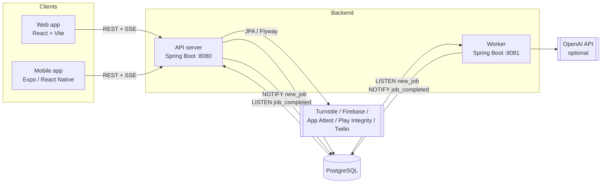

# Architecture

This document covers how Foundry is built and the patterns every new feature should reuse.
For naming and code style, see [conventions.md](conventions.md). For every tunable property, see [configuration-guide.md](configuration-guide.md).

## 1. System overview



| Module | Responsibility |
|--------|----------------|
| `common` | JPA entities (`User`, `OtpVerification`, `RefreshToken`, `AsyncJob`, `Note`), enums (`JobType`, `JobStatus`) and Spring Data repositories. A plain library (no Boot plugin) shared by the API and the worker. |
| `api-server` | All HTTP endpoints, authentication, validation, feature flags, rate limiting, Flyway migrations (the API owns the schema), SSE fan-out. |
| `worker` | Claims and runs background jobs, retries, heartbeats, stale-job recovery, LLM client. Uses `ddl-auto=validate` and never migrates the schema. |
| `web-app` | Public web client. It only uses anonymous (JWE) access. |
| `mobile-app` | Full client: anonymous access, phone login (JWT), profile, notes, jobs. |

## 2. API server layering

```
controller/   @RestController — HTTP mapping, @Valid DTOs, @FeatureFlag, returns records
services/     @Service — business logic, @Transactional boundaries, throws domain exceptions
common/repository  Spring Data JPA repositories (shared)
model/dto/    Java records for requests/responses (never expose entities)
config/       @ConfigurationProperties records, filters, Security/Cache/I18n config
security/     token filter, claims, RequestIdentity, @FeatureFlag aspect
```

Request pipeline (servlet filters in order): `RequestIdFilter` (adds `X-Request-Id`, MDC `rid`) → `TokenQueryParamFilter` (redacts `?token=` from logs) → `TokenAuthenticationFilter` (parses the bearer token into request attributes) → `RateLimitFilter` → Spring MVC → `FeatureFlagAspect` → controller.

Errors: `GlobalExceptionHandler` (`@RestControllerAdvice`) maps exceptions to **RFC 7807** `application/problem+json` responses (`type`, `title`, `status`, `detail`). The `title`/`detail` text comes from `i18n/messages_{vi,en}.properties` through `MessageSource`, and the locale comes from `Accept-Language` (Vietnamese is the default).

## 3. Identity and authentication

There are two token types, both sent as `Authorization: Bearer <token>`:

| Token | Format | Issued by | Identifies | Typical TTL |
|-------|--------|-----------|------------|-------------|
| **Anonymous** | JWE (5 dot-separated parts, A256GCM, `nimbus-jose-jwt`) | `POST /turnstile/verify` (web, Cloudflare Turnstile) or `POST /device/verify` (mobile, App Attest / Play Integrity) | a random anonymous id; the API keeps a SHA-256 hash of the token | 24 h |
| **Authenticated** | JWT (HS512 access token) + opaque refresh token | `POST /auth/verify-otp` (server SMS OTP via Twilio/NoOp) or `POST /auth/verify-firebase-token` (Firebase phone auth) | `users.id` (UUIDv7) | access 60 min, refresh 30 days (rotated, at most 5 per user, stored hashed) |

`TokenAuthenticationFilter` tells the two apart by the number of dots. It stores `tokenClaims` (and for JWE also `anonymousTokenHash`) as request attributes. Endpoints decide what they accept:

- **Public**: health, features, mobile config, token issuing.
- **Anonymous or authenticated**: `POST /jobs/echo`, job status and stream. The owner is recorded as an `ownerKey` (`user:<uuid>` or `anon:<tokenHash>`; see `RequestIdentity`).
- **Authenticated only**: `/users/**`, `/notes/**`. A missing token or a JWE token returns 401.

Refresh flow: clients call `POST /auth/refresh` when they get a 401. The mobile axios client queues requests made during the refresh. `POST /auth/logout` revokes the refresh token.

Account deletion: `DELETE /users/account` (OTP confirmed) sets `deleted=true` and `deletion_scheduled_at`. `AccountCleanupScheduler` anonymizes the account and removes its data after `account.deletion.grace-period-days`.

## 4. Background-job pattern

Any slow or external work (LLM calls, report generation, imports) goes through `async_jobs` instead of blocking a request.

```mermaid
sequenceDiagram
    participant C as Client
    participant A as API
    participant P as PostgreSQL
    participant W as Worker
    C->>A: POST /api/v1/jobs/echo
    A->>P: INSERT async_jobs (PENDING, owner_key, parameters_hash)
    A->>P: NOTIFY new_job '<jobId>'
    A-->>C: 202 {jobId, status: PENDING}
    C->>A: GET /jobs/{id}/stream (SSE)
    P-->>W: LISTEN new_job (or fallback poll every 30 s)
    W->>P: SELECT ... FOR UPDATE SKIP LOCKED → RUNNING
    W->>W: JobProcessor.process(job) + heartbeat
    W->>P: UPDATE result, COMPLETED; NOTIFY job_completed '<jobId>'
    P-->>A: LISTEN job_completed
    A-->>C: SSE event "completed" {jobId, result}
```

Key properties:

- **Idempotency**: `parameters_hash` (SHA-256 of the parameters plus the owner) has a partial unique index over PENDING/RUNNING jobs, so a duplicate submission returns the existing job.
- **Safe concurrency**: workers claim jobs with `FOR UPDATE SKIP LOCKED`, so any number of worker replicas can run.
- **Retries**: `RetryableException` sends the job back to PENDING until `max_retries`. `NonRetryableException` / `PermanentJobException` marks it FAILED with `message`.
- **Heartbeat and stale recovery**: running jobs update `updated_at` every `worker.job.heartbeat-interval-sec`. `StaleJobRecoveryTask` resets RUNNING jobs older than `stale-timeout-minutes`.
- **Graceful shutdown**: on SIGTERM the worker finishes short jobs and requeues long ones (`graceful-shutdown-threshold-sec`).
- **Delivery to clients**: SSE (`SseSubscriptionRegistry`, heartbeat comments every 15 s). Clients fall back to polling `GET /jobs/{id}/status` (2 s, then ×2, capped at 15 s; the values come from `/config/mobile`). With several API replicas, each replica LISTENs and pushes only to its own subscribers.
- **Plug-in point**: implement `worker/.../job/JobProcessor` (`supportedType()` + `process(job)` returning the result map) as a Spring bean. `JobDispatcher` routes jobs to it by `JobType`.

Operations runbook: [worker/docs/README.md](../worker/docs/README.md).

## 5. Configuration model

```
application.properties (safe defaults)            ← code reads @ConfigurationProperties records
   ↑ overridden by
Helm values.yaml → ConfigMap → /config/application-override.properties (SPRING_CONFIG_ADDITIONAL_LOCATION)
   ↑ secrets from
Helm --set / CI variables → Kubernetes Secret → env vars (AUTH_JWE_SECRET_KEY, ...)
```

- No business value is hard-coded. Every limit, TTL and flag is a property with a default and is documented in [configuration-guide.md](configuration-guide.md).
- **Feature flags** are a generic map, `feature.flags.<key>.enabled`. Annotate a controller method with `@FeatureFlag("<key>")` to return 503 `FEATURE_DISABLED` when the flag is off. Flags are exposed at `GET /api/v1/features` and in `GET /api/v1/config/mobile`, and clients hide the matching UI.
- Prompt templates for the worker are files (`echo_prompt.system.txt`, ...) mounted from a ConfigMap at `/etc/opt/foundry/config`. If a file is missing, the worker falls back to `classpath:prompts/`.

## 6. Data conventions

- Every primary key is a **UUIDv7**, generated in Java (`UuidCreator.getTimeOrderedEpoch()` in `@PrePersist`). Clients only ever see UUIDs.
- Flyway migrations live in `api-server/src/main/resources/db/migration/V{N}__description.sql`. They are append-only: never edit a migration that has been applied.
- `updated_at` is maintained by the `update_updated_at_column()` trigger (V6). Add a trigger for each new table.
- JSON columns use `jsonb` with `@JdbcTypeCode(SqlTypes.JSON)`.

## 7. Clients

| Concern | Web (`web-app`) | Mobile (`mobile-app`) |
|---------|-----------------|------------------------|
| Routing | `react-router-dom` (`/`, `/jobs/:jobId`) | Expo Router file-based tabs: `home`, `notes`, `account`, plus an `(auth)` modal |
| State | Redux Toolkit (`tokenSlice`, `jobsSlice`) | Redux Toolkit + redux-persist (secure storage for tokens) |
| API | axios instance, `X-Platform: WEB`, 401 clears the token | axios instance, `X-Platform: MOBILE`, 401 refreshes the token (with a queue) |
| Anonymous token | Turnstile widget → `/turnstile/verify` | `useDeviceAttestation` → `/device/verify` |
| Real-time | `@microsoft/fetch-event-source` (Authorization header) + polling fallback | `react-native-sse` + polling fallback (`useJobProgress`) |
| i18n | react-i18next, `vi` default, `en` fallback | react-i18next, `vi` default, `en` fallback |
| Styling | Tailwind semantic tokens (CSS variables, `dark:` support) | `src/theme` tokens (colors, spacing, typography) |
| Tests | Vitest + Testing Library | Jest (`jest-expo`) + Detox smoke test |

## 8. Observability

- Logs: Logback JSON (`logstash-logback-encoder`), with the `rid` request id in the MDC. The id is propagated to `async_jobs.correlation_id`.
- Metrics: Micrometer Prometheus at `/actuator/prometheus` (e.g. `worker_jobs_processed_total`, `worker_jobs_queue_depth`, `http_server_requests_seconds`).
- Health: `/actuator/health/{liveness,readiness}` drive the Kubernetes probes.
- `monitoring/` contains ServiceMonitors, PrometheusRules (queue depth, job failure rate, OTP failures, latency, restarts) and Grafana dashboards.

## 9. Security checklist (built in)

- Bot protection for anonymous web tokens (Turnstile) and device attestation for mobile.
- Bearer-only auth with no cookies, so CSRF does not apply. CORS origins are configured per environment.
- Rate limiting per IP and endpoint class (`security.rate-limit.*`), and a request body size limit.
- OTP: hashed codes, an attempt limit, an hourly rate limit and a resend cooldown.
- Refresh tokens are stored hashed, rotated on use and revocable.
- Tokens passed as query parameters are redacted from logs.
- Ownership checks: jobs by `owner_key`, notes by `user_id`. Another user's resource returns 404 so its existence is not revealed.
- Secrets come only from env vars or Kubernetes Secrets. Never commit `.env` or the Firebase config files.
