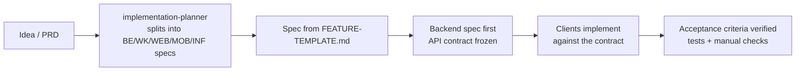

# Development Workflow

Foundry is built with **feature specs**: small, self-contained markdown documents in `docs/features/`. Each one is implemented by a specialised Copilot agent (or a developer) and checked against its acceptance criteria.

## Feature IDs

| Prefix | Scope | Agent |
|--------|-------|-------|
| `BE-xxx` | API server, `common`, Flyway | `feature-developer` |
| `WK-xxx` | Worker / background jobs | `feature-developer` |
| `INF-xxx` | Helm, CI/CD, monitoring, Makefile | `feature-developer` |
| `WEB-xxx` | `web-app/` | `Expert React Frontend Engineer` |
| `MOB-xxx` | `mobile-app/` | `mobile-feature-developer` |

File name: `docs/features/{ID}-{kebab-title}.md`, e.g. `BE-002-invoices-api.md`.

## Lifecycle

1. **Plan**: ask `implementation-planner` to break a product requirement into specs.
2. **Specify**: copy [features/FEATURE-TEMPLATE.md](features/FEATURE-TEMPLATE.md). Fill in the API contract (paths, request/response JSON, status codes, errors) **before** any client work starts.
3. **Order**: backend (`BE`/`WK`) → infra (`INF`, if new config or secrets) → clients (`WEB`/`MOB`). List the dependencies in each spec.
4. **Implement**: in Copilot Chat, select the agent and say `implement BE-002`. The agent reads the spec, the architecture and the conventions, then writes the code and tests.
5. **Verify**: run `make test` (and `make test-all` with Docker), plus the manual checks listed in the spec.

## Examples

The demo features are documented as reference specs:

| Spec | What it shows |
|------|---------------|
| [BE-001-notes-api](features/BE-001-notes-api.md) | Owner-scoped CRUD, pagination, feature flag, migrations, tests |
| [WK-001-echo-job](features/WK-001-echo-job.md) | Async job end to end: API enqueue → worker processor → SSE |
| [WEB-001-home-echo-demo](features/WEB-001-home-echo-demo.md) | Turnstile anonymous token, job submission, live progress page |
| [MOB-001-notes](features/MOB-001-notes.md) | Auth-gated tab, list/edit screens, slice + service |
| [INF-001-helm-charts](features/INF-001-helm-charts.md) | Helm values → ConfigMap/Secret, environment overrides |

## Definition of done

- All acceptance criteria are met and tests are added (unit + integration/component).
- No hard-coded business values. New properties are documented in [configuration-guide.md](configuration-guide.md) and mirrored in Helm.
- i18n keys exist in `vi` and `en`.
- `./mvnw -q -DskipTests install`, `npm test` (web), and `npm run typecheck && npm run lint && npm test` (mobile) all pass.
